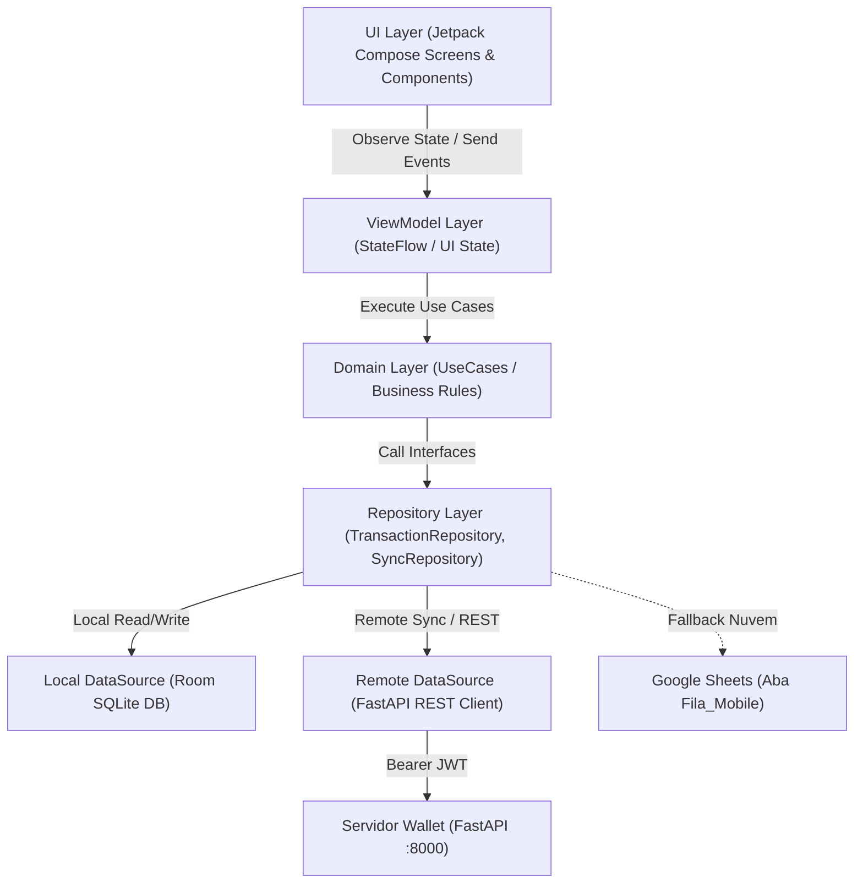

# Wallet Mobile - Especificação Completa de Arquitetura & Implementação Android (Fase 2)

Este documento estabelece as diretrizes de arquitetura, contratos de dados, fluxos de telas, estratégias de sincronização offline-first e a estrutura de código recomendada para o desenvolvimento do aplicativo mobile nativo do **Wallet** no **Android Studio**.

---

## 1. Visão Geral do Aplicativo Mobile

O aplicativo mobile foi concebido como uma extensão ágil e "local-first" do ecossistema **Wallet**. Seu objetivo primordial é permitir que o usuário:
1. Registre despesas e receitas instantaneamente na rua com poucos toques (*Quick Entry*).
2. Tire fotos de comprovantes fiscais/recibos na hora e anexe às transações.
3. Consulte rapidamente seu saldo em contas, faturas de cartão de crédito e contas a vencer no dia.
4. Funcione **100% Offline** (persistindo em banco de dados local Room/SQLite) e sincronize de forma transparente quando houver conexão via API REST ou Google Sheets.
5. Proteja o acesso por **Biometria** (impressão digital / reconhecimento facial).

---

## 2. Stack Tecnológica Recomendada (Android Studio)

| Componente | Tecnologia | Justificativa |
| :--- | :--- | :--- |
| **Linguagem** | **Kotlin 2.0+** | Padrão oficial Android, conciso, seguro contra nullabilidade e suporte nativo a Coroutines. |
| **Interface / UI** | **Jetpack Compose + Material 3** | UI declarativa moderna, suporte nativo a Dark Mode dinâmico, animações fluidas e alta produtividade. |
| **Persistência Local** | **Room (SQLite)** | Camada de abstração ORM com suporte a `Flow` e `suspend functions`, garantindo arquitetura offline-first. |
| **Cliente HTTP** | **Retrofit 2 + OkHttp 3** | Cliente REST assíncrono com interceptores de autenticação JWT Bearer e suporte a logs (HttpLoggingInterceptor). |
| **Serialização** | **Kotlinx Serialization** ou **Moshi** | Serialização JSON ultrarrápida, tipada e com suporte a null safety. |
| **Injeção de Dependência** | **Hilt (Dagger)** ou **Koin** | Gerenciamento de ciclo de vida e injeção de dependências em ViewModels, DAOs e Repositórios. |
| **Tarefas em Segundo Plano** | **WorkManager** | Sincronização offline em background confiável e com políticas de retry automático e restrições de rede (`NetworkType.CONNECTED`). |
| **Segurança & Biometria** | **AndroidX Biometric + EncryptedSharedPreferences** | Autenticação biométrica (`BiometricPrompt`) e armazenamento seguro de tokens JWT e configurações. |
| **Câmera & Comprovantes** | **CameraX** / `ActivityResultContracts.TakePicture` | Captura simplificada de fotos de notas fiscais e comprovantes. |

---

## 3. Arquitetura do Aplicativo (Clean Architecture + MVVM / MVI)



---

## 4. Modelagem de Dados Local (Room Entities & DTOs)

### 4.1 Regra Invariável: Valores Monetários em Centavos Inteiros
Assim como no backend, todo valor monetário no Android **DEVE** ser manipulado e persistido como `Long` ou `Int` representando centavos (`amount_cents`). Nunca utilize `Float` ou `Double` para cálculos ou armazenamento financeiro.
- `R$ 15,50` $\rightarrow$ `1550L`
- `R$ 1.250,00` $\rightarrow$ `125000L`

### 4.2 Entidades Principais do Room (`@Entity`)

#### `TransactionEntity`
```kotlin
@Entity(
    tableName = "transactions",
    indices = [
        Index("profile"),
        Index("due_date"),
        Index("sync_status"),
        Index("status")
    ]
)
data class TransactionEntity(
    @PrimaryKey
    val id: String = UUID.randomUUID().toString(),
    val profile: String, // "PESSOAL" ou "EMPRESA"
    val type: String, // "DESPESA", "RECEITA", "TRANSFERENCIA"
    val description: String,
    val amountCents: Long,
    val dueDate: String, // "YYYY-MM-DD"
    val paymentDate: String? = null, // "YYYY-MM-DD"
    val status: String = "PENDENTE", // "PENDENTE", "CONCLUIDO", "CANCELADO"
    val categoryId: String? = null,
    val categoryName: String? = null,
    val accountId: String? = null,
    val accountName: String? = null,
    val destinationAccountId: String? = null,
    val destinationAccountName: String? = null,
    val paymentMethodId: String? = null,
    val paymentMethodName: String? = null,
    val creditCardId: String? = null,
    val creditCardName: String? = null,
    val contactId: String? = null,
    val contactName: String? = null,
    val itemId: String? = null,
    val notes: String? = null,
    val installmentNumber: Int? = null,
    val totalInstallments: Int? = null,
    val syncStatus: String = "PENDENTE", // "PENDENTE", "SINCRONIZADO", "ERRO"
    val localAttachmentPath: String? = null, // Caminho URI local da foto do comprovante
    val remoteAttachmentId: String? = null,
    val createdAt: String = SimpleDateFormat("yyyy-MM-dd'T'HH:mm:ss", Locale.US).format(Date()),
    val updatedAt: String = SimpleDateFormat("yyyy-MM-dd'T'HH:mm:ss", Locale.US).format(Date())
)
```

#### `CategoryEntity`
```kotlin
@Entity(tableName = "categories")
data class CategoryEntity(
    @PrimaryKey val id: String,
    val profile: String, // "PESSOAL" ou "EMPRESA"
    val name: String,
    val type: String, // "RECEITA" ou "DESPESA"
    val nature: String = "NENHUM" // "OBRIGATORIO", "NECESSARIO", "DESEJO", "NENHUM"
)
```

#### `AccountEntity` & `CreditCardEntity`
```kotlin
@Entity(tableName = "accounts")
data class AccountEntity(
    @PrimaryKey val id: String,
    val profile: String,
    val name: String,
    val type: String // "CORRENTE", "POUPANCA", "INVESTIMENTO", "CAIXA", "OUTRO"
)

@Entity(tableName = "credit_cards")
data class CreditCardEntity(
    @PrimaryKey val id: String,
    val profile: String,
    val name: String,
    val limitCents: Long,
    val usedLimitCents: Long = 0,
    val availableLimitCents: Long = 0,
    val closingDay: Int,
    val dueDay: Int,
    val color: String = "emerald",
    val brand: String? = "MASTERCARD",
    val accountId: String? = null
)
```

#### `PaymentMethodEntity` & `ItemEntity`
```kotlin
@Entity(tableName = "payment_methods")
data class PaymentMethodEntity(
    @PrimaryKey val id: String,
    val profile: String,
    val name: String,
    val type: String // "PIX", "BOLETO", "CARTAO_CREDITO", "CARTAO_DEBITO", "DINHEIRO", "TRANSFERENCIA", "DEBITO_AUTOMATICO", "OUTRO"
)

@Entity(tableName = "items")
data class ItemEntity(
    @PrimaryKey val id: String,
    val profile: String,
    val name: String,
    val categoryId: String,
    val defaultAmountCents: Long? = null
)
```

---

## 5. Contratos de API REST (FastAPI) para o Retrofit

### 5.1 Definição da Interface `WalletApiService`

```kotlin
interface WalletApiService {

    // 1. Autenticação
    @FormUrlEncoded
    @POST("api/v1/auth/login")
    suspend fun login(
        @Field("username") username: String,
        @Field("password") password: String
    ): AuthTokenResponse

    @GET("api/v1/auth/me")
    suspend fun getCurrentUser(): UserResponse

    // 2. Dados Mestres (Sincronização de Cadastros)
    @GET("api/v1/categories")
    suspend fun getCategories(@Query("profile") profile: String): List<CategoryResponse>

    @GET("api/v1/accounts")
    suspend fun getAccounts(@Query("profile") profile: String): List<AccountResponse>

    @GET("api/v1/payment-methods")
    suspend fun getPaymentMethods(@Query("profile") profile: String): List<PaymentMethodResponse>

    @GET("api/v1/credit-cards")
    suspend fun getCreditCards(@Query("profile") profile: String): List<CreditCardResponse>

    @GET("api/v1/items")
    suspend fun getItems(@Query("profile") profile: String): List<ItemResponse>

    @GET("api/v1/contacts")
    suspend fun getContacts(@Query("profile") profile: String): List<ContactResponse>

    // 3. Transações
    @GET("api/v1/transactions")
    suspend fun getTransactions(
        @Query("profile") profile: String,
        @Query("month") month: Int? = null,
        @Query("year") year: Int? = null,
        @Query("status") status: String? = null,
        @Query("limit") limit: Int = 100
    ): List<TransactionResponse>

    @POST("api/v1/transactions")
    suspend fun createTransaction(@Body request: TransactionCreateRequest): TransactionResponse

    @PUT("api/v1/transactions/{id}")
    suspend fun updateTransaction(
        @Path("id") id: String,
        @Body request: TransactionUpdateRequest
    ): TransactionResponse

    @PATCH("api/v1/transactions/{id}/toggle-status")
    suspend fun toggleTransactionStatus(@Path("id") id: String): TransactionResponse

    @DELETE("api/v1/transactions/{id}")
    suspend fun deleteTransaction(@Path("id") id: String): Response<Unit>

    // 4. Upload de Comprovantes
    @Multipart
    @POST("api/v1/attachments/upload")
    suspend fun uploadAttachment(
        @Part file: MultipartBody.Part,
        @Query("profile") profile: String,
        @Query("attachment_type") attachmentType: String = "COMPROVANTE",
        @Query("transaction_id") transactionId: String? = null
    ): AttachmentResponse

    // 5. Dashboard & KPIs
    @GET("api/v1/dashboard/summary")
    suspend fun getDashboardSummary(
        @Query("profile") profile: String,
        @Query("month") month: Int? = null,
        @Query("year") year: Int? = null
    ): DashboardSummaryResponse
}
```

---

## 6. Fluxos de Telas & UX no Jetpack Compose

```
App Navigation
├── AuthNavGraph
│   ├── ConnectionSetupScreen (Configurar URL do servidor FastAPI / IP local / Host)
│   ├── LoginScreen (Usuário, Senha, Biometria)
│   └── BiometricPrompt (Desbloqueio rápido)
└── MainNavGraph (Bottom Navigation Bar)
    ├── HomeScreen (Dashboard, KPIs do mês, Saldo em contas, Cartões, Alertas de vencimento)
    ├── TransactionsScreen (Lista com busca, filtros de mês/status e toggle rápido de baixa)
    ├── QuickEntryBottomSheet / Screen (Lançamento ágil com valor em destaque, teclado numérico BRL, foto)
    ├── CreditCardsScreen (Faturas, limites e melhor dia de compra)
    └── SettingsScreen (Perfil ativo, status da sincronização, diretório e logout)
```

### 6.1 Detalhamento da Tela "Quick Entry" (Lançamento Rápido)
Esta é a tela mais importante do mobile:
1. **Input de Valor Gigante (Hero Component)**: Formatação instantânea em BRL (`R$ 0,00`) conforme o usuário digita no teclado numérico customizado.
2. **Chips de Tipo**: `Despesa` (padrão em vermelho), `Receita` (verde), `Transferência` (índigo).
3. **Seleção de Perfil**: Switch rápido `PESSOAL` | `EMPRESA`.
4. **Campo de Descrição**: Com auto-completar inteligente por `Itens` cadastrados.
5. **Seletor de Categoria**: Grid com ícones e cores por natureza (`Obrigatório`, `Necessário`, `Desejo`).
6. **Forma de Pagamento & Conta / Cartão**: Seleção em 1 toque (Pix, Dinheiro, Cartão Nubank, etc.).
7. **Botão de Câmera 📷**: Tira foto da nota/recibo que é salva localmente e colocada na fila de upload.
8. **Botão Salvar**: Salva instantaneamente no Room local (< 10ms) e despacha o `SyncWorker` em segundo plano.

---

## 7. Estratégia de Sincronização e Resiliência (Offline-First)

### 7.1 Cenário 1: Conectado na Rede Local / Servidor Ativo (Online)
1. O app envia a transação via `POST /api/v1/transactions`.
2. Se houver comprovante capturado, envia via `POST /api/v1/attachments/upload`.
3. Ao receber a resposta `201 Created`, atualiza o registro no Room com `syncStatus = "SINCRONIZADO"`.

### 7.2 Cenário 2: Sem Internet / Fora da Rede Local (Offline)
1. A transação é salva no Room com `syncStatus = "PENDENTE"`.
2. A foto é persistida no armazenamento interno seguro do app (`context.filesDir/receipts/`).
3. O app exibe o item na lista imediatamente com um ícone sutil de "Aguardando sincronização" (nuvem com relógio).
4. Um job do **WorkManager** (`SyncWorker`) é agendado com a restrição `Constraints.Builder().setRequiredNetworkType(NetworkType.CONNECTED).build()`.
5. Quando o aparelho reconectar à rede do servidor (ou VPN/Tailscale):
   - O `SyncWorker` executa em background.
   - Sobe todas as transações com `syncStatus == "PENDENTE"`.
   - Faz o upload dos arquivos de imagem pendentes.
   - Atualiza o banco local com os dados atualizados do servidor.

### 7.3 Cenário 3: Fallback via Google Sheets (`Fila_Mobile`)
Caso o servidor FastAPI local não possua IP público ou VPN ativa e o usuário esteja na rede celular:
- O app pode gravar diretamente na aba `Fila_Mobile` da Planilha Google configurada (utilizando as credenciais OAuth da conta Google do usuário ou webhook Apps Script).
- Quando o usuário abrir a aplicação web em casa ou o backend rodar a sincronização, o FastAPI importa e processa a `Fila_Mobile` automaticamente.

---

## 8. Estrutura de Pacotes Sugerida para o Android Studio

```
app/src/main/java/com/wallet/app/
├── data/
│   ├── local/
│   │   ├── AppDatabase.kt
│   │   ├── dao/
│   │   │   ├── TransactionDao.kt
│   │   │   ├── CategoryDao.kt
│   │   │   ├── AccountDao.kt
│   │   │   └── CreditCardDao.kt
│   │   └── entity/
│   │       ├── TransactionEntity.kt
│   │       └── ...
│   ├── remote/
│   │   ├── WalletApiService.kt
│   │   ├── AuthInterceptor.kt
│   │   └── dto/
│   │       ├── TransactionDto.kt
│   │       └── ...
│   └── repository/
│       ├── TransactionRepositoryImpl.kt
│       ├── MasterDataRepositoryImpl.kt
│       └── AuthRepositoryImpl.kt
├── domain/
│   ├── model/
│   │   ├── Transaction.kt
│   │   ├── Category.kt
│   │   └── Profile.kt
│   ├── repository/
│   │   ├── TransactionRepository.kt
│   │   └── AuthRepository.kt
│   └── usecase/
│       ├── SaveQuickTransactionUseCase.kt
│       ├── SyncPendingTransactionsUseCase.kt
│       └── GetDashboardSummaryUseCase.kt
├── ui/
│   ├── theme/
│   │   ├── Color.kt
│   │   ├── Theme.kt (Dark/Light Material 3)
│   │   └── Type.kt
│   ├── components/
│   │   ├── CurrencyInputVisualTransformation.kt
│   │   ├── AmountHeroCard.kt
│   │   ├── CategoryChipGrid.kt
│   │   └── AttachmentCaptureButton.kt
│   ├── navigation/
│   │   ├── NavGraph.kt
│   │   └── Screen.kt
│   ├── home/
│   │   ├── HomeScreen.kt
│   │   └── HomeViewModel.kt
│   ├── entry/
│   │   ├── QuickEntryScreen.kt
│   │   └── QuickEntryViewModel.kt
│   ├── transactions/
│   │   ├── TransactionsScreen.kt
│   │   └── TransactionsViewModel.kt
│   ├── creditcards/
│   │   ├── CreditCardsScreen.kt
│   │   └── CreditCardsViewModel.kt
│   └── settings/
│       ├── SettingsScreen.kt
│       └── SettingsViewModel.kt
├── worker/
│   └── SyncWorker.kt
└── WalletApplication.kt
```

---

## 9. Permissões Necessárias (`AndroidManifest.xml`)

```xml
<manifest xmlns:android="http://schemas.android.com/apk/res/android">

    <!-- Conectividade -->
    <uses-permission android:name="android.permission.INTERNET" />
    <uses-permission android:name="android.permission.ACCESS_NETWORK_STATE" />

    <!-- Biometria -->
    <uses-permission android:name="android.permission.USE_BIOMETRIC" />

    <!-- Câmera para comprovantes fiscais -->
    <uses-feature android:name="android.hardware.camera" android:required="false" />
    <uses-permission android:name="android.permission.CAMERA" />

    <!-- Notificações de contas a vencer (Android 13+) -->
    <uses-permission android:name="android.permission.POST_NOTIFICATIONS" />

    <application
        android:name=".WalletApplication"
        android:allowBackup="true"
        android:usesCleartextTraffic="true" <!-- Permitir HTTP para testes locais na rede WiFi -->
        android:theme="@style/Theme.WalletApp">
        ...
    </application>
</manifest>
```

---

## 10. Checklist de Inicialização no Android Studio

Ao abrir o **Android Studio**:
- [ ] Criar novo projeto: **Empty Compose Activity** (Material 3).
- [ ] Configurar `compileSdk = 35`, `minSdk = 26` (Android 8.0+), `targetSdk = 35`.
- [ ] Adicionar dependências no `libs.versions.toml`:
  - `androidx-room-runtime`, `androidx-room-compiler`, `androidx-room-ktx`
  - `retrofit`, `retrofit-converter-kotlinx-serialization` (ou moshi)
  - `okhttp-logging-interceptor`
  - `androidx-work-runtime-ktx`
  - `androidx-biometric`
  - `androidx-navigation-compose`
  - `coil-compose` (para exibição de fotos de comprovantes)
  - `hilt-android`, `hilt-compiler` (ou Koin)
- [ ] Configurar a URL base da API apontando para o IP da máquina local ou emulador (no emulador Android padrão, `http://10.0.2.2:8000/`).
- [ ] Implementar a tela de `QuickEntryScreen` com persistência local no Room.
- [ ] Testar a sincronização assíncrona com o backend FastAPI.
