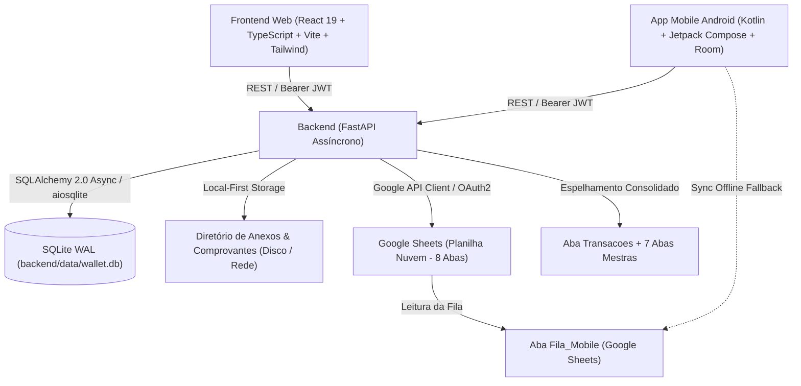

# Wallet - Arquitetura Técnica (.ai/ARCHITECTURE.md)

## 1. Diagrama Geral do Sistema



---

## 2. Componentes do Backend

### 2.1 Stack & Bibliotecas
- **Linguagem**: Python 3.10+
- **Framework Web**: FastAPI `>= 0.111.0`
- **Servidor ASGI**: Uvicorn `[standard]`
- **ORM & Persistência**: SQLAlchemy 2.0 Async + `aiosqlite`
- **Validação de Dados**: Pydantic v2 + `pydantic-settings`
- **Segurança & Criptografia**: `passlib[bcrypt]` nativo + `python-jose` (JWT HS256)
- **Integração Google Sheets & Drive**: `google-api-python-client`, `google-auth-httplib2`, `google-auth-oauthlib`
- **Manipulação de Arquivos & Backups**: `shutil`, `zipfile`, `aiofiles`, `tempfile`

### 2.2 Estrutura de Diretórios
```
backend/
├── app/
│   ├── api/
│   │   └── v1/            # 19 Roteadores REST completos (auth, transactions, cards, planning, etc.)
│   ├── core/
│   │   ├── config.py      # Configurações via variáveis de ambiente (.env)
│   │   └── security.py    # Utilitários de hash bcrypt e criação/validação de tokens JWT
│   ├── models/            # Modelos declarativos SQLAlchemy (User, Transaction, CreditCard, Goal, etc.)
│   ├── schemas/           # Schemas Pydantic v2 de entrada e serialização de saída
│   ├── services/          # Regras de negócio (ScheduleService, GoogleSheetsService, ConciliationService, etc.)
│   ├── database.py        # Configuração de AsyncEngine SQLite WAL e sessão AsyncSession
│   └── main.py            # Instância FastAPI, CORS, migrações dinâmicas e lifespan com seeding
├── data/
│   ├── wallet.db          # Arquivo principal do banco de dados SQLite local
│   └── attachments/       # Armazenamento padrão de comprovantes (organizado por perfil/ano/mês)
├── requirements.txt       # Dependências Python
└── venv/                  # Ambiente virtual isolado
```

### 2.3 Convenções e Tabela Consolidada de Endpoints REST (19 Roteadores)

| Domínio | Método | Rota | Descrição |
| :--- | :--- | :--- | :--- |
| **Auth** | `POST` | `/api/v1/auth/login` | Autenticação de usuário e senha, retornando token JWT Bearer. |
| **Auth** | `GET` | `/api/v1/auth/me` | Retorna dados e permissões do usuário logado. |
| **Usuários** | `GET` | `/api/v1/auth/users` | Listagem de usuários do sistema. |
| **Usuários** | `POST` | `/api/v1/auth/register` | Cadastro seguro de novo usuário. |
| **Usuários** | `DELETE` | `/api/v1/auth/users/{id}` | Exclusão de usuário com proteção do último admin. |
| **Contas** | `GET` / `POST` | `/api/v1/accounts` | Gestão de contas bancárias, carteiras e aplicações. |
| **Formas de Pagamento** | `GET` / `POST` | `/api/v1/payment-methods` | Meios de liquidação (Pix, Boleto, Cartões, Dinheiro, Débito). |
| **Cartões de Crédito** | `GET` / `POST` | `/api/v1/credit-cards` | Gestão de cartões, limites em centavos, dia de fechamento e vencimento. |
| **Faturas de Cartão** | `GET` | `/api/v1/credit-cards/{id}/invoices/{month}/{year}` | Extrato detalhado da fatura do cartão com compras e status. |
| **Faturas de Cartão** | `POST` | `/api/v1/credit-cards/{id}/invoices/{month}/{year}/settle` | Liquidação consolidada em 1 clique com geração de débito bancário. |
| **Faturas de Cartão** | `POST` | `/api/v1/credit-cards/{id}/invoices/{month}/{year}/reopen` | Reabertura e estorno do pagamento da fatura. |
| **Categorias** | `GET` / `POST` | `/api/v1/categories` | Categorias diretas com classificação por natureza (`CategoryNature`). |
| **Itens** | `GET` / `POST` | `/api/v1/items` | Catálogo de itens com valor sugerido para preenchimento ágil. |
| **Contatos** | `GET` / `POST` | `/api/v1/contacts` | Cadastro de clientes, fornecedores e prestadores. |
| **Extrato do Contato** | `GET` | `/api/v1/contacts/{id}/statement` | Conta-corrente individual com movimentações e KPIs do contato. |
| **Dívidas** | `GET` / `POST` | `/api/v1/debts` | Gestão de passivos e acompanhamento de amortização. |
| **Orçamentos** | `GET` / `POST` | `/api/v1/budgets` | Tetos mensais de gastos por categoria e alertas de estouro. |
| **Metas Financeiras** | `GET` / `POST` | `/api/v1/goals` | Objetivos financeiros, reserva e patrimônio com aportes/resgates. |
| **Metas Financeiras** | `POST` | `/api/v1/goals/{id}/contribute` | Registrar aporte ou resgate com atualização automática de status. |
| **Transações** | `GET` / `POST` | `/api/v1/transactions` | Lançamentos de despesas, receitas e transferências patrimoniais. |
| **Transações** | `PUT` / `DELETE` | `/api/v1/transactions/{id}` | Edição completa e exclusão atômica de lançamentos. |
| **Transações** | `PATCH` | `/api/v1/transactions/{id}/toggle-status` | Toggle de quitação (Pendente $\leftrightarrow$ Concluído) em 1 clique. |
| **Transações** | `PATCH` | `/api/v1/transactions/{id}/uncomplete` | Reabertura de lançamento com restauração de saldo devedor. |
| **Ações em Lote** | `POST` | `/api/v1/transactions/batch/complete` | Baixa em massa de múltiplos lançamentos selecionados. |
| **Ações em Lote** | `POST` | `/api/v1/transactions/batch/uncomplete` | Reabertura em massa de múltiplos lançamentos. |
| **Ações em Lote** | `POST` | `/api/v1/transactions/batch/update` | Atualização seletiva em massa de múltiplos campos. |
| **Ações em Lote** | `POST` | `/api/v1/transactions/batch/delete` | Exclusão em lote de transações. |
| **Schedules / Recorrências**| `GET` / `POST` | `/api/v1/schedules` | Central de contratos, parcelamentos e assinaturas mensais. |
| **Schedules / Recorrências**| `POST` | `/api/v1/schedules/{id}/adjust` | Reajuste de valor/vencimento em lançamentos futuros pendentes. |
| **Schedules / Recorrências**| `POST` | `/api/v1/schedules/{id}/action` | Pausar, reativar ou cancelar contrato/assinatura. |
| **Comprovantes & Anexos** | `POST` | `/api/v1/attachments/upload` | Upload com tipificação (Comprovante, NF, Fatura, Recibo, Contrato). |
| **Comprovantes & Anexos** | `GET` | `/api/v1/attachments/view/{id}` | Visualização inline de imagens e PDFs com cache HTTP. |
| **Comprovantes & Anexos** | `GET` | `/api/v1/attachments/download/{id}` | Download direto do comprovante com filename original. |
| **Comprovantes & Anexos** | `GET` / `POST` | `/api/v1/attachments/storage-dir` | Consulta, alteração e migração automática de diretório físico. |
| **Dashboard** | `GET` | `/api/v1/dashboard/summary` | KPIs consolidados, saldos por conta, 50-30-20 e timeline 7 dias. |
| **Planejamento** | `GET` | `/api/v1/planning/projection` | Fluxo de caixa projetado de 12 a 24 meses com curva patrimonial. |
| **Planejamento** | `POST` | `/api/v1/planning/simulate` | Simulador What-If interativo com sensibilidade de receitas/despesas. |
| **Planejamento** | `GET` | `/api/v1/planning/runway` | Fôlego de caixa, reserva de emergência, FIRE 4% e Burn Rate PJ. |
| **Planejamento** | `GET` | `/api/v1/planning/goals-projection` | Projeção temporal de metas com taxa de juros compostos. |
| **Planejamento** | `GET` | `/api/v1/planning/committed-income` | Análise de renda comprometida por contratos e cartões. |
| **Conciliação Bancária** | `POST` | `/api/v1/conciliation/parse` | Parser OFX/CSV com detecção de duplicidades e sugestão de categorias. |
| **Conciliação Bancária** | `POST` | `/api/v1/conciliation/import` | Importação e gravação transacional em lote de extratos bancários PJ. |
| **Sistema & Backups** | `GET` | `/api/v1/system/stats` | Estatísticas de tamanho de banco, contagem de anexos e uso de disco. |
| **Sistema & Backups** | `GET` | `/api/v1/system/backup` | Download de backup consolidado em 1 clique (.ZIP com DB + Anexos). |
| **Sincronização Nuvem** | `GET` / `POST` | `/api/v1/sync/config` | Leitura e atualização de credenciais Google e ID da planilha. |
| **Sincronização Nuvem** | `GET` | `/api/v1/sync/status` | Detecção em tempo real de pendências de envio e recebimento da fila. |
| **Sincronização Nuvem** | `POST` | `/api/v1/sync/test` | Teste de conexão e permissões com as APIs Google Sheets e Drive. |
| **Sincronização Nuvem** | `POST` | `/api/v1/sync/export` | Exportação atômica em lote para as abas espelho da planilha. |
| **Sincronização Nuvem** | `POST` | `/api/v1/sync/import` | Ingestão e conciliação de lançamentos da aba `Fila_Mobile`. |
| **Sincronização Nuvem** | `POST` | `/api/v1/sync/full` | Sincronização completa de ida e volta (import + export). |
| **Sincronização Nuvem** | `GET` | `/api/v1/sync/logs` | Histórico e logs de auditoria de sincronização. |

---

## 3. Integração com Google Sheets (Espelho Integral & Fila Mobile)

### 3.1 Estrutura das 8 Abas da Planilha
1. **`Transacoes`**: Espelho analítico de receitas, despesas e transferências com metadados e IDs.
2. **`Categorias`**: Árvore com nomes, tipos e natureza de essencialidade.
3. **`Itens`**: Catálogo de itens vinculados a categorias com valor sugerido.
4. **`Contas`**: Contas bancárias, carteiras e aplicações cadastradas.
5. **`Contatos`**: Cadastro consolidado de clientes, fornecedores e favorecidos.
6. **`Dividas`**: Passivos, credores, valor total/restante e status.
7. **`Orcamentos`**: Tetos mensais de gastos por categoria.
8. **`Fila_Mobile`**: Fila de recepção para lançamentos inseridos remotamente pelo app mobile Android.

---

## 4. Componentes do Frontend Web

### 4.1 Stack & Bibliotecas
- **Framework**: React 19 + TypeScript
- **Bundler / Dev Server**: Vite 8+
- **Estilização**: Tailwind CSS 3.4 + PostCSS
- **Ícones**: Lucide React
- **Cliente HTTP**: Axios com interceptor de autenticação JWT Bearer e tratamento centralizado de erros.

---

## 5. Componentes do Aplicativo Mobile Android (Fase 2)

- **Linguagem & UI**: Kotlin 2.0+ com Jetpack Compose e Material 3.
- **Persistência Local (Offline-First)**: Room Database (SQLite local) com DAOs reativos.
- **Camada de Rede**: Retrofit 2 + OkHttp 3 com interceptor de autenticação JWT.
- **Background Sync**: WorkManager para envio e recebimento de dados em segundo plano.
- **Segurança**: BiometricPrompt para login instantâneo e EncryptedSharedPreferences para credenciais.
- **Especificação Completa**: Consulte [.ai/ANDROID_APP.md](.ai/ANDROID_APP.md).
