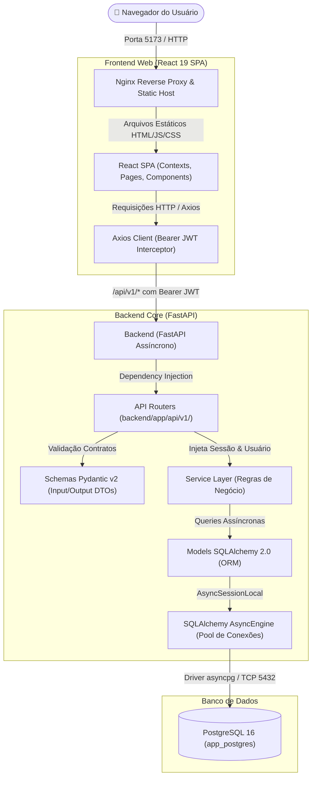

# Arquitetura Técnica do Sistema (.ai/ARCHITECTURE.md)

Este documento é a **referência técnica primária e canônica** da arquitetura do sistema. Ele foi projetado para orientar desenvolvedores e **Agentes de IA** a compreenderem a estrutura completa, os fluxos de dados, os contratos e os padrões adotados tanto no **Backend** quanto no **Frontend**.

---

## 1. Visão Geral da Topologia e Infraestrutura

A aplicação é dividida em três pilares fundamentais:
1. **Frontend SPA**: Aplicação cliente em React 19 + TypeScript + Vite + Tailwind CSS.
2. **Backend API**: Servidor RESTful assíncrono em Python 3.10+ com FastAPI e SQLAlchemy 2.0.
3. **Persistência**: Banco de dados relacional **PostgreSQL 16** com pool de conexões assíncrono via `asyncpg`.



---

## 2. Arquitetura do Backend (Python / FastAPI)

### 2.1 Stack Tecnológica e Bibliotecas Principais
- **Linguagem**: Python 3.10+
- **Framework Web**: FastAPI `>= 0.111.0` (suporte a OpenAPI automático e validações nativas)
- **Servidor ASGI**: Uvicorn `[standard]`
- **ORM & Persistência**: SQLAlchemy 2.0 Async + driver assíncrono `asyncpg>=0.29.0`
- **Validação e Serialização**: Pydantic v2 + `pydantic-settings`
- **Segurança**: `passlib[bcrypt]` para hash de senhas e `python-jose[cryptography]` para tokens JWT HS256

### 2.2 Divisão Estrita de Camadas
```
backend/app/
├── api/
│   └── v1/
│       ├── __init__.py       # Agregação do api_router central
│       ├── auth.py           # Endpoints de autenticação (/login, /register, /me)
│       ├── deps.py           # Dependências injetáveis (get_current_user, get_current_admin_user)
│       └── items.py          # Endpoints do CRUD de exemplo (/items)
├── core/
│   ├── config.py             # Configurações com validação Pydantic e resolução de DATABASE_URL
│   └── security.py           # Funções puras de hashing (bcrypt) e geração de JWT
├── models/                   # Entidades declarativas SQLAlchemy 2.0 (Mapped, mapped_column)
│   ├── __init__.py           # Exportação e registro de todos os modelos no metadata
│   ├── user.py               # Modelo de usuários e credenciais
│   └── item.py               # Modelo scaffold de itens
├── schemas/                  # Contratos de dados Pydantic v2 (DTOs)
│   ├── __init__.py
│   ├── user.py               # UserCreate, UserResponse, Token, TokenData
│   └── item.py               # ItemBase, ItemCreate, ItemUpdate, ItemResponse, ItemFilter
├── services/                 # Regras de negócio desacopladas da camada HTTP
│   ├── __init__.py
│   └── item_service.py       # Operações atômicas de CRUD e regras de negócio
├── database.py               # AsyncEngine com connection pool, Base declarativa e get_db
└── main.py                   # Instância FastAPI, CORS, lifespan assíncrono e healthcheck
```

### 2.3 Padrão de Persistência com PostgreSQL
- **Connection Pool**: O engine assíncrono opera com pool gerenciado (`pool_size=10`, `max_overflow=20`, `pool_pre_ping=True`, `pool_recycle=300`).
- **Gerenciamento de Sessão (`get_db`)**:
  ```python
  async def get_db():
      async with AsyncSessionLocal() as session:
          try:
              yield session
          finally:
              await session.close()
  ```
- **Transações Atômicas**:
  Todas as operações de escrita nos *services* devem executar `await db.commit()` e `await db.refresh(entity)`. Em caso de erro não tratado, o context manager encerra a sessão revertendo alterações pendentes.
- **Tipagem de Chaves e Datas**:
  - Chaves Primárias: UUID v4 serializado em `String(36)` ou `UUID(as_uuid=True)`.
  - Timestamps: ISO-8601 em UTC (`String(30)` ou `TIMESTAMP WITH TIME ZONE`).

---

## 3. Arquitetura do Frontend Web (React 19 / TypeScript)

### 3.1 Stack Tecnológica
- **Framework**: React 19
- **Linguagem**: TypeScript 5.7+ (modo estrito, sem uso de `any`)
- **Bundler & Dev Server**: Vite 6+
- **Estilização**: Tailwind CSS 3.4 com suporte nativo a `darkMode: "class"`
- **Ícones**: Lucide React
- **Cliente HTTP**: Axios centralizado com interceptor para injeção automática de `Bearer <token>`

### 3.2 Divisão de Camadas no Frontend
```
frontend/src/
├── api/
│   └── client.ts             # Instância Axios central com interceptors de Request (JWT) e Response (401)
├── components/               # Componentes UI reutilizáveis e layouts
│   ├── Header.tsx            # Barra superior com navegação, tema e logout
│   ├── Layout.tsx            # Envelope estrutural com Header, main container e Footer
│   └── Modal.tsx             # Modal acessível e responsivo reutilizável
├── context/                  # Provedores de estado global React
│   ├── AuthContext.tsx       # Gerencia token JWT, dados do usuário logado e login/logout
│   └── ThemeContext.tsx      # Gerencia alternância e persistência do tema (light/dark) no localStorage
├── pages/                    # Telas completas da aplicação
│   ├── Login.tsx             # Tela de login e cadastro com formulário reativo
│   ├── Dashboard.tsx         # Dashboard com cards de métricas e status da API
│   └── Items.tsx             # Tela completa de gestão e CRUD de itens
├── types/                    # Definições estritas de interfaces e tipos TypeScript
│   └── index.ts              # User, AuthResponse, Item, ItemCreateInput, ItemFilterParams, etc.
├── utils/                    # Funções utilitárias puras
│   └── format.ts             # Formatadores de data, texto e moeda
├── App.tsx                   # Roteamento central e orquestração de telas autenticadas
├── main.tsx                  # Ponto de entrada (ThemeContext -> AuthContext -> App)
└── index.css                 # Configuração Tailwind e utilitários globais
```

### 3.3 Ciclo de Vida de Autenticação e Interceptação HTTP
1. **Login com Sucesso**: O token JWT retornado por `/api/v1/auth/login` é armazenado no `localStorage` sob a chave `auth_token`.
2. **Request Interceptor (`frontend/src/api/client.ts`)**: Injeta automaticamente o cabeçalho `Authorization: Bearer <token>` em todas as requisições para endpoints protegidos.
3. **Response Interceptor (`frontend/src/api/client.ts`)**: Ao capturar status HTTP `401 Unauthorized`, remove o token expirado do `localStorage` e redireciona o usuário para a tela de autenticação.
4. **Theme Engine**: O `ThemeContext` adiciona/remove a classe `.dark` no elemento `<html>` do documento e salva a preferência no `localStorage`.

---

## 4. Tabela de Endpoints da API Base

| Módulo | Método | Rota | Autenticação | Descrição |
| :--- | :--- | :--- | :--- | :--- |
| **Auth** | `POST` | `/api/v1/auth/login` | Pública | Login via form `username` e `password`, retorna token JWT Bearer. |
| **Auth** | `POST` | `/api/v1/auth/register` | Pública | Registro de novo usuário no sistema. |
| **Auth** | `GET` | `/api/v1/auth/me` | Bearer JWT | Retorna os dados do usuário autenticado atual. |
| **Items** | `GET` | `/api/v1/items` | Bearer JWT | Listagem com suporte a filtro de status, busca textual e paginação. |
| **Items** | `POST` | `/api/v1/items` | Bearer JWT | Criação de novo item vinculado opcionalmente ao usuário logado. |
| **Items** | `GET` | `/api/v1/items/{id}` | Bearer JWT | Busca detalhada de item por UUID. |
| **Items** | `PUT` | `/api/v1/items/{id}` | Bearer JWT | Atualização parcial ou completa de item. |
| **Items** | `DELETE`| `/api/v1/items/{id}` | Bearer JWT | Remoção atômica de item do banco de dados. |
| **Sistema** | `GET` | `/api/health` | Pública | Healthcheck da API e verificação ativa da conexão PostgreSQL (`SELECT 1`). |

---

## 5. Diretrizes Fundamentais para Agentes de IA

Ao implementar novas features, agentes de IA devem consultar os manuais dedicados:
- [.ai/BACKEND_GUIDE.md](file:///home/jsilvaneto/projetos/wallet/projetos/.ai/BACKEND_GUIDE.md): Passo a passo para novos models, migrations, schemas, services e rotas.
- [.ai/FRONTEND_GUIDE.md](file:///home/jsilvaneto/projetos/wallet/projetos/.ai/FRONTEND_GUIDE.md): Passo a passo para novas páginas, componentes, types e consumo de API.
- [.ai/STATUS.md](file:///home/jsilvaneto/projetos/wallet/projetos/.ai/STATUS.md): Checklist de governança e roadmap de releases.
