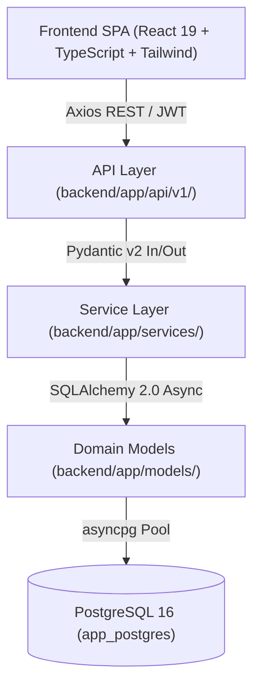

# Diretrizes e Manual Operacional para Agentes de IA (AGENT_RULES.md)

Este documento estabelece as diretrizes mandatórias de desenvolvimento, padrões arquiteturais e governança de contexto para qualquer **Agente de IA** atuando em projetos baseados neste boilerplate.

---

## 1. Visão Geral da Arquitetura

A base adota separação estrita de responsabilidades, garantindo desacoplamento entre apresentação, regras de negócio e infraestrutura de persistência.

### 1.1 Divisão de Camadas no Backend
- `backend/app/core/`: Configurações de ambiente (`config.py` com `pydantic-settings`) e utilitários de segurança/criptografia (`security.py`). Não contém regras de negócio.
- `backend/app/database.py`: Ponto central de persistência com PostgreSQL 16 (AsyncEngine, pool de conexões gerenciado via `asyncpg`, `AsyncSessionLocal` e injeção `get_db`).
- `backend/app/models/`: Entidades de banco de dados puras via SQLAlchemy 2.0 com `Mapped[...]` e `mapped_column(...)`. Proibido conter lógica HTTP ou schemas de serialização.
- `backend/app/schemas/`: Contratos de entrada e saída serializados via Pydantic v2 com `ConfigDict(from_attributes=True)`. Proibido conter queries de banco de dados.
- `backend/app/services/`: Lógica de negócios desacoplada. Realiza queries, transações com `db.commit()` / `db.rollback()`, validações de regras e lança exceções de domínio ou `HTTPException`.
- `backend/app/api/v1/`: Roteadores HTTP FastAPI. Valida permissões (`deps.py`), injeta `AsyncSession`, invoca os serviços e retorna modelos de schema.

### 1.2 Divisão de Camadas no Frontend
- `frontend/src/api/client.ts`: Instância Axios centralizada com interceptor de autenticação JWT e tratamento unificado de 401.
- `frontend/src/types/index.ts`: Tipagem TypeScript estrita de todos os contratos, entidades, filtros e retornos de API.
- `frontend/src/context/`: Provedores de estado global (`AuthContext`, `ThemeContext`).
- `frontend/src/components/`: Componentes UI reutilizáveis, modais e layouts de apresentação pura.
- `frontend/src/pages/`: Telas completas que orquestram requisições à API, formulários e renderizam componentes.

---

## 2. Regras Mandatórias de Código

1. **Nunca misture lógica de infraestrutura com lógica de negócios**:
   - Queries SQL e regras de manipulação de dados nunca devem ser escritas diretamente em endpoints HTTP ou em componentes do React. Use a camada de serviços (`backend/app/services/`).
2. **Tipagem Estrita Obrigatória**:
   - **Backend**: Todo método/função deve ter type annotations completos em parâmetros e retornos (ex: `async def list_items(db: AsyncSession, filter: ItemFilter) -> Sequence[Item]:`).
   - **Frontend**: Proibido uso de `any`. Todas as props de componentes, estados e retornos de requisições devem ter interfaces definidas em `types/index.ts`.
3. **Assincronismo Total no Backend**:
   - Todas as funções de rotas, dependências e serviços devem ser `async def`.
   - Utilize `await db.execute(...)`, `await db.commit()`, `await session.refresh(...)`.
4. **Persistência PostgreSQL 16**:
   - O banco de dados opera com driver assíncrono `asyncpg`, pool de conexões gerenciado e transações atômicas com `await db.commit()`.
5. **Tratamento de Exceções**:
   - Falhas esperadas de negócio devem retornar `HTTPException` com códigos semânticos adequados (`400 Bad Request`, `401 Unauthorized`, `403 Forbidden`, `404 Not Found`, `409 Conflict`).
   - Erros não capturados são interceptados pelo FastAPI retornando status `500`.
6. **Design System & Temas**:
   - Qualquer novo componente ou tela no Frontend DEVE suportar nativamente **Modo Claro** e **Modo Escuro** (*Dark Mode*) utilizando classes utilitárias do Tailwind CSS (ex: `bg-white dark:bg-zinc-900 text-zinc-900 dark:text-zinc-100`).

---

## 3. Instruções para o Agente: Como Estender a Aplicação

Quando você receber um novo requisito funcional para adicionar uma nova entidade ou recurso, siga **obrigatoriamente** o fluxo abaixo:

### Passo 1: Modelagem Relacional (Backend)
1. Crie o arquivo em `backend/app/models/<nova_entidade>.py` usando SQLAlchemy 2.0.
2. Registre a exportação do modelo em `backend/app/models/__init__.py`.
3. Adicione chaves estrangeiras com `ForeignKey(..., ondelete=...)` e índices em campos de busca frequente.

### Passo 2: Schemas de Validação (Backend)
1. Crie o arquivo em `backend/app/schemas/<nova_entidade>.py` usando Pydantic v2.
2. Defina os schemas: `<Entidade>Base`, `<Entidade>Create`, `<Entidade>Update`, `<Entidade>Response`.
3. Em `<Entidade>Response`, utilize `model_config = ConfigDict(from_attributes=True)`.
4. Exporte em `backend/app/schemas/__init__.py`.

### Passo 3: Camada de Serviços (Backend)
1. Crie `backend/app/services/<nova_entidade>_service.py`.
2. Implemente funções com responsabilidade única: `get_*`, `list_*`, `create_*`, `update_*`, `delete_*`.
3. Utilize transações atômicas com `await db.commit()` e trate regras de negócio.

### Passo 4: Roteador de API (Backend)
1. Crie `backend/app/api/v1/<nova_entidade>.py`.
2. Injete `db: AsyncSession = Depends(get_db)` e `current_user: User = Depends(get_current_user)`.
3. Registre o roteador em `backend/app/api/v1/__init__.py` no `api_router`.

### Passo 5: Contratos de Tipagem (Frontend)
1. Abra `frontend/src/types/index.ts` e declare a interface da entidade e os tipos de requisição.

### Passo 6: Componentes e Páginas (Frontend)
1. Crie a tela correspondente em `frontend/src/pages/<NovaEntidade>.tsx`.
2. Implemente busca, estados de loading, mensagens de erro e feedback visual.
3. Adicione a rota ou navegação correspondente em `frontend/src/App.tsx`.

### Passo 7: Documentação e Checklist
1. Atualize o checklist em `.ai/STATUS.md`.
2. Se houver nova decisão técnica estrutural, crie um novo ADR em `.ai/DECISIONS/`.

---

## 4. Arquitetura de Skills para Agentes de IA (`.agents/`)

Este repositório possui suporte nativo ao sistema de customizações e **Skills** para Agentes de IA:

- **Localização**: `.agents/skills/<skill-name>/SKILL.md`
- **Skills Disponíveis**:
  - `add-new-entity`: Passo a passo detalhado e scripts para criar novas entidades full-stack.
  - `api-testing-suite`: Criação e execução de testes assíncronos de integração com Pytest e HTTPX.
  - `contract-sync`: Sincronização entre schemas Pydantic v2 e interfaces TypeScript do frontend.
  - `database-migrations`: Diretrizes de evolução de schema em PostgreSQL 16 com Alembic.
  - `database-ops`: Operações de backup (`pg_dump`), restore, reseeds e diagnósticos no PostgreSQL.
  - `financial-domain-guard`: Regras de finanças pessoais, integridade de valores sempre em centavos (`amount_cents`) e escopo vinculado ao usuário autenticado.
  - `run-and-test`: Instruções para build, lint e testes automatizados.
  - `security-guard`: Diretrizes de DevSecOps, blindagem de segredos, sanitização e dependências seguras.
  - `token-optimizer`: Protocolo cirúrgico para economia de tokens e otimização de contexto.
  - `ui-design-system`: Padrões visuais Tailwind CSS, Dark Mode obrigatório e componentes reutilizáveis.
- **Regras Mandatórias (`.agents/rules/*.md`)**:
  - `coding_standards.md`: Tipagem estrita sem `any`, convenções de nomes, tratamento de exceções e dark mode.
  - `architecture.md`: Separação rígida de camadas e proibição de queries ou chamadas diretas fora do padrão.
  - `test_data_cleanup.md`: Política mandatória de Resíduo Zero: remoção imediata de dados de teste do banco e arquivos temporários.
